# CiteVerify AI
### Scientific Claim and Citation Verification System
**INNOVEDGE 2026 Hackathon | Problem Statement 03**

CiteVerify AI is an automated, evidence-grounded verification platform that evaluates the integrity of citations in academic research papers. A user uploads an academic PDF; the system validates the file, extracts factual and empirical claims, identifies attached in-text citations and bibliography references, retrieves cited publications from free scholarly APIs (Crossref, OpenAlex, Europe PMC), extracts evidence passages, and evaluates whether the cited publication genuinely supports the factual assertion. The final output is an interactive dashboard and structured audit report with transparent reasoning and human-review flags.

> [!IMPORTANT]
> **Core Principle:** A real citation does not automatically support its claim. We verify the claim against the evidence.

---

## 2. 16-Step Verification Pipeline

```mermaid
flowchart TD
    S1["1. User Uploads PDF"] --> S2["2. Validate File (magic bytes %PDF-, MIME, size)"]
    S2 --> S3["3. PDF Processor Extracts Page Text (detects scanned/no-text)"]
    S3 --> S4["4. Claim Extractor Isolates Factual Empirical Claims"]
    S4 --> S5["5. Citation Parser Detects In-Text Markers ([1], Smith 2020)"]
    S5 --> S6["6. Reference Parser Extracts Bibliography Section"]
    S6 --> S7["7. Citation Matcher Links Claims to Reference Entries"]
    S7 --> S8["8. Research Services Query Crossref & OpenAlex (Europe PMC)"]
    S8 --> S9["9. Publication Metadata Matched with Confidence & Reason"]
    S9 --> S10["10. Accessible Abstracts or Legitimate OA Full-Text Retrieved"]
    S10 --> S11["11. Evidence Extractor Isolates & Chunks Relevant Passages"]
    S11 --> S12["12. Embedding Service Ranks Passages Semantically Against Claim"]
    S12 --> S13["13. Verification Engine Compares Exact Claim with Evidence"]
    S13 --> S14["14. Structured JSON Results Produced & Validated Against Contract"]
    S14 --> S15["15. Human-Review Flags Assigned for Inconclusive/Contradictory Cases"]
    S15 --> S16["16. Final Verification Report & Interactive Dashboard Rendered"]
```



---

## 3. Tech Stack

| Component | Framework / Technology | Version (Detected) | Purpose |
|---|---|---|---|
| **Runtime (System)** | Python | `3.13.16` | Backend services, AI logic, and data ingestion |
| **Runtime (Frontend)** | Node.js | `v24.22.1` | Next.js development and build execution |
| **Package Manager** | npm | `11.19.1` | Frontend package installation |
| **Backend Framework** | FastAPI | `0.165.0` | High-performance asynchronous REST API |
| **ASGI Server** | Uvicorn | `0.54.0` | Production ASGI web server |
| **Data Validation** | Pydantic v2 | `2.14.3` | Contract schema validation and serialisation |
| **Settings Management**| Pydantic-Settings | `2.16.3` | Environment variable parsing |
| **Frontend Framework** | Next.js (App Router) | `14.2.15` | Server-rendered React client interface |
| **Styling** | Tailwind CSS | `3.4.13` | Utility-first responsive design |
| **Scholarly APIs** | Crossref / OpenAlex / Europe PMC | REST APIs | Free public scholarly literature discovery (polite pools) |
| **Database** | In-Memory / SQLite (Postgres ready) | Python built-in | Zero-credential default repository interface |
| **Testing** | pytest | `8.4.2` | Automated unit, contract, and validator testing |
| **Version Control** | Git | `2.56.0` | Monorepo branch management and collaboration |

---

## 4. Repository Map

```
CiteVerify-AI/
├── frontend/          # Next.js 14 App Router, TypeScript, Tailwind CSS (Owner: Agent 1)
├── backend/           # FastAPI app, document validator, DB repository, orchestrator (Owner: Agent 2)
├── ai_engine/         # Claim extractor, embeddings, LLM verification reasoning (Owner: Agent 3)
├── research_services/ # Crossref, OpenAlex, Europe PMC integrations (Owner: Agent 4)
├── contracts/         # Canonical SSOT: OpenAPI 3.1.0, JSON schemas, canonical enums (Shared: All 4 Agents)
├── docs/              # Specifications, architecture, contracts, database schema, guides (Shared: All 4 Agents)
├── .agent/            # Agent ground rules and development workflows (Shared: All 4 Agents)
├── .github/           # Issue templates, PR template, CODEOWNERS, CI workflow (Owner: Agent 2 / DevOps)
├── tests/             # Cross-module integration, end-to-end test plans, benchmark paper guides (Shared)
└── scripts/           # Environment checks, dev runner, health probe, contract validation (Owner: Agent 2)
```

---

## 5. Team Roles & Ownership

| Developer / Agent | Role | Directory Ownership | Reference Guide |
|---|---|---|---|
| **Agent 1** | Frontend Architect | `frontend/**` | [docs/agents/01-frontend.md](docs/agents/01-frontend.md) |
| **Agent 2** | Backend Architect | `backend/**`, `scripts/**` | [docs/agents/02-backend.md](docs/agents/02-backend.md) |
| **Agent 3** | AI/ML Engineer | `ai_engine/**` | [docs/agents/03-ai-ml.md](docs/agents/03-ai-ml.md) |
| **Agent 4** | Research Integration | `research_services/**`, `tests/integration/**` | [docs/agents/04-research-integration.md](docs/agents/04-research-integration.md) |
| **Team Consensus** | Integration Lead | `contracts/**`, `docs/**` | [docs/agents/OWNERSHIP.md](docs/agents/OWNERSHIP.md) |

---

## 6. Verification Statuses vs. Processing Statuses

> [!IMPORTANT]
> **Processing Status and Verification Verdict are strictly separated.**

- **`ProcessingStatus` (Document Pipeline State):**
  - `PENDING`: Uploaded, awaiting queue pickup.
  - `PROCESSING`: Pipeline actively running.
  - `COMPLETED`: Pipeline completed; report ready.
  - `FAILED`: Pipeline halted due to an unrecoverable error.

- **`VerificationVerdict` (Claim Evaluation Outcome):**
  - `SUPPORTED`: Source empirical evidence directly confirms the claim.
  - `PARTLY_SUPPORTED`: Source confirms partially or with unmentioned caveats.
  - `UNSUPPORTED`: Source does not provide empirical evidence for this claim.
  - `CONTRADICTORY`: Source evidence directly refutes or contradicts the claim.
  - `POTENTIALLY_OUTDATED`: Source supported it when written, but newer literature supersedes it.
  - `null`: When evidence is inconclusive or retrieval failed, `verdict = null` and `verification_state = UNABLE_TO_VERIFY` or `REQUIRES_HUMAN_REVIEW`.

---

## 7. Hard Honesty Rules

1. **Never Fabricate:** Never invent publications, DOIs, quotes, evidence passages, or test results.
2. **Abstracts vs. Full-Text:** An abstract is never presented as full text. Every evidence item explicitly sets `evidence_level` (`FULL_TEXT`, `ABSTRACT_ONLY`, `METADATA_ONLY`, `NONE`).
3. **Retrieval Failure is Not Refutation:** A paper that cannot be retrieved or is paywalled is NOT marked false or unsupported. It becomes `UNABLE_TO_VERIFY` with `needs_human_review = true`.
4. **Insufficient Evidence is Never Forced:** If retrieved text does not address the claim, `verdict` remains `null`.
5. **Traceability:** Every verdict must be traceable to a source (DOI/URL, provider, passage, evidence level).

---

## 8. Quick Start

### 8.1. Clone & Set Up Backend Environment

#### In Git Bash:
```bash
# Clone and enter directory
cd CiteVerify-AI

# Create virtual environment and activate
python -m venv backend/.venv
source backend/.venv/Scripts/activate

# Install dependencies
pip install -r backend/requirements.txt
pip install -r backend/requirements-dev.txt

# Copy environment config
cp .env.example .env

# Run backend server
uvicorn app.main:app --app-dir backend --host 127.0.0.1 --port 8000 --reload
```

#### In PowerShell:
```powershell
# Clone and enter directory
cd CiteVerify-AI

# Create virtual environment and activate
python -m venv backend\.venv
backend\.venv\Scripts\Activate.ps1

# Install dependencies
pip install -r backend\requirements.txt
pip install -r backend\requirements-dev.txt

# Copy environment config
Copy-Item .env.example .env

# Run backend server
backend\.venv\Scripts\python.exe -m uvicorn app.main:app --app-dir backend --host 127.0.0.1 --port 8000 --reload
```

### 8.2. Set Up Frontend

```bash
cd frontend
npm install
npm run dev
```
Open `http://localhost:3000` in your browser.

### 8.3. Run Health Check & Validation
```bash
# In another terminal:
python scripts/health_check.py
python scripts/validate_repo.py
backend/.venv/Scripts/pytest backend/tests -v
```

---

## 9. Key Documentation Links

- [API Contract Specification](docs/API_CONTRACT.md)
- [Canonical OpenAPI Specification](contracts/openapi/openapi.yaml)
- [System Architecture](docs/ARCHITECTURE.md)
- [Database Schema & ER Diagram](docs/DATABASE_SCHEMA.md)
- [Pipeline Data Flow](docs/DATA_FLOW.md)
- [Hackathon 24-Hour Roadmap](docs/HACKATHON_ROADMAP.md)
- [Git Workflow & Collaboration Rules](docs/GIT_WORKFLOW.md)
- [Production Deployment Guide](docs/DEPLOYMENT.md)
- [Testing & Quality Assurance](docs/TESTING.md)
- [Integration Guide](docs/INTEGRATION_GUIDE.md)
- [Troubleshooting & Windows Guide](docs/TROUBLESHOOTING.md)

---

## 10. Current Foundation Status Checklist

- [x] Environment audit and tool inspection completed (`docs/ENVIRONMENT.md`).
- [x] Monorepo directory structure established with `__init__.py` files.
- [x] Root configurations committed (`.gitignore`, `.gitattributes`, `.editorconfig`, `.env.example`).
- [x] Canonical contracts created (`enums.json`, OpenAPI 3.1.0, JSON schemas).
- [x] Pydantic v2 schemas and TypeScript interfaces synchronized with zero drift.
- [x] Synthetic mock fixtures created in `contracts/examples/` with `_synthetic: true`.
- [x] Backend FastAPI application running with CORS, request-ID tracing, and error envelope handlers.
- [x] In-memory repository interface implemented for zero-credential local development.
- [x] File upload validator enforcing %PDF- magic bytes, MIME, and size limits.
- [x] Backend service stubs documented with ownership, signatures, inputs, and outputs.
- [x] Backend pytest test suite (13/13 passing) including contract drift and upload tests.
- [x] Live `GET /api/health` probe verified returning `200 OK`.
- [x] Frontend Next.js 14 App Router, TypeScript, and Tailwind CSS configured and building (`npm run build` passing).
- [x] Agent specifications, rules, workflows, issue templates, and CI configuration committed.
- [ ] Multi-page PDF text extraction (Scheduled: Hours 2–6).
- [ ] Claim extraction few-shot prompt (Scheduled: Hours 2–6).
- [ ] Crossref & OpenAlex API integration (Scheduled: Hours 6–10).
- [ ] LLM verification reasoning & report generation (Scheduled: Hours 10–15).

