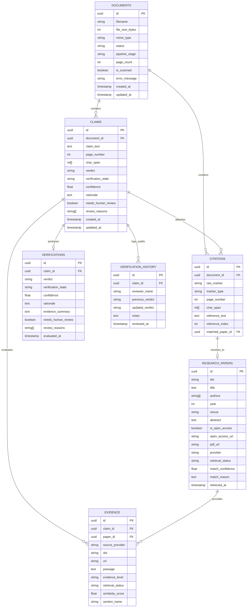

# Database Schema & Entity Relationships

This document outlines the relational data model for CiteVerify AI.
The system defaults to an in-memory/SQLite repository for zero-credential local development, with a production-ready PostgreSQL / Supabase DDL schema specified below.

---

## 1. Entity-Relationship Diagram (Mermaid)



---

## 2. Table Specifications

### 2.1. `documents`
- `id` (UUID, Primary Key): Unique document identifier.
- `filename` (VARCHAR(255), NOT NULL): Uploaded file name.
- `file_size_bytes` (INTEGER, NOT NULL): File byte length.
- `mime_type` (VARCHAR(50), NOT NULL, DEFAULT 'application/pdf'): MIME type.
- `status` (VARCHAR(50), NOT NULL): Enum `ProcessingStatus` (`PENDING`, `PROCESSING`, `COMPLETED`, `FAILED`).
- `pipeline_stage` (VARCHAR(50), NOT NULL): Enum `PipelineStage`.
- `page_count` (INTEGER, NULL): Detected page count.
- `is_scanned` (BOOLEAN, DEFAULT FALSE): Flag for image-only PDFs.
- `error_message` (TEXT, NULL): Failure reason if pipeline aborted.
- `created_at`, `updated_at` (TIMESTAMPTZ, NOT NULL).

### 2.2. `claims`
- `id` (UUID, Primary Key).
- `document_id` (UUID, Foreign Key -> `documents.id` ON DELETE CASCADE).
- `claim_text` (TEXT, NOT NULL): The factual assertion text.
- `page_number` (INTEGER, NOT NULL).
- `char_span` (INTEGER[2], NOT NULL): `[start_char, end_char]` offsets.
- `verdict` (VARCHAR(50), NULL): Enum `VerificationVerdict` (`SUPPORTED`, etc.). Nullable if insufficient evidence.
- `verification_state` (VARCHAR(50), NOT NULL): Enum `VerificationState`.
- `confidence` (FLOAT, NOT NULL, DEFAULT 0.0).
- `rationale` (TEXT, NOT NULL, DEFAULT '').
- `needs_human_review` (BOOLEAN, NOT NULL, DEFAULT FALSE).
- `review_reasons` (TEXT[], NOT NULL, DEFAULT '{}').
- `created_at`, `updated_at` (TIMESTAMPTZ, NOT NULL).

### 2.3. `citations`
- `id` (UUID, Primary Key).
- `document_id` (UUID, Foreign Key -> `documents.id` ON DELETE CASCADE).
- `raw_marker` (VARCHAR(100), NOT NULL): E.g. `[1]` or `(Smith et al., 2020)`.
- `marker_type` (VARCHAR(50), NOT NULL): `NUMERIC` or `AUTHOR_YEAR`.
- `page_number` (INTEGER, NOT NULL).
- `char_span` (INTEGER[2], NULL).
- `reference_text` (TEXT, NULL): Full bibliographic string from References.
- `reference_index` (INTEGER, NULL).
- `matched_paper_id` (UUID, NULL, Foreign Key -> `research_papers.id` ON DELETE SET NULL).

### 2.4. `research_papers`
- `id` (UUID, Primary Key).
- `doi` (VARCHAR(255), NULL).
- `title` (TEXT, NOT NULL).
- `authors` (TEXT[], NOT NULL, DEFAULT '{}').
- `year` (INTEGER, NULL).
- `venue` (VARCHAR(255), NULL).
- `abstract` (TEXT, NULL).
- `is_open_access` (BOOLEAN, NOT NULL, DEFAULT FALSE).
- `open_access_url` (TEXT, NULL).
- `pdf_url` (TEXT, NULL).
- `provider` (VARCHAR(50), NOT NULL): `crossref`, `openalex`, `europe_pmc`.
- `retrieval_status` (VARCHAR(50), NOT NULL): Enum `RetrievalStatus`.
- `match_confidence` (FLOAT, NOT NULL): 0.0 to 1.0.
- `match_reason` (TEXT, NULL).
- `retrieved_at` (TIMESTAMPTZ, NOT NULL).

### 2.5. `evidence`
- `id` (UUID, Primary Key).
- `paper_id` (UUID, NULL, Foreign Key -> `research_papers.id` ON DELETE CASCADE).
- `source_provider` (VARCHAR(50), NOT NULL).
- `doi` (VARCHAR(255), NULL).
- `url` (TEXT, NULL).
- `passage` (TEXT, NOT NULL): Extracted excerpt.
- `evidence_level` (VARCHAR(50), NOT NULL): Enum `EvidenceLevel`.
- `retrieval_status` (VARCHAR(50), NOT NULL): Enum `RetrievalStatus`.
- `similarity_score` (FLOAT, NULL): Cosine score.
- `section_name` (VARCHAR(100), NULL).

### 2.6. `verification_history`
- `id` (UUID, Primary Key).
- `claim_id` (UUID, Foreign Key -> `claims.id` ON DELETE CASCADE).
- `reviewer_name` (VARCHAR(255), NOT NULL).
- `previous_verdict` (VARCHAR(50), NULL).
- `updated_verdict` (VARCHAR(50), NOT NULL).
- `notes` (TEXT, NOT NULL).
- `reviewed_at` (TIMESTAMPTZ, NOT NULL, DEFAULT NOW()).

---

## 3. Production PostgreSQL DDL Script

```sql
-- PostgreSQL 15+ Schema for CiteVerify AI
CREATE EXTENSION IF NOT EXISTS "uuid-ossp";

CREATE TABLE documents (
    id UUID PRIMARY KEY DEFAULT uuid_generate_v4(),
    filename VARCHAR(255) NOT NULL,
    file_size_bytes INT NOT NULL,
    mime_type VARCHAR(50) NOT NULL DEFAULT 'application/pdf',
    status VARCHAR(50) NOT NULL,
    pipeline_stage VARCHAR(50) NOT NULL,
    page_count INT,
    is_scanned BOOLEAN DEFAULT FALSE,
    error_message TEXT,
    created_at TIMESTAMPTZ NOT NULL DEFAULT NOW(),
    updated_at TIMESTAMPTZ NOT NULL DEFAULT NOW()
);

CREATE TABLE research_papers (
    id UUID PRIMARY KEY DEFAULT uuid_generate_v4(),
    doi VARCHAR(255),
    title TEXT NOT NULL,
    authors TEXT[] DEFAULT '{}',
    year INT,
    venue VARCHAR(255),
    abstract TEXT,
    is_open_access BOOLEAN DEFAULT FALSE,
    open_access_url TEXT,
    pdf_url TEXT,
    provider VARCHAR(50) NOT NULL,
    retrieval_status VARCHAR(50) NOT NULL,
    match_confidence REAL NOT NULL,
    match_reason TEXT,
    retrieved_at TIMESTAMPTZ NOT NULL DEFAULT NOW()
);

CREATE TABLE citations (
    id UUID PRIMARY KEY DEFAULT uuid_generate_v4(),
    document_id UUID NOT NULL REFERENCES documents(id) ON DELETE CASCADE,
    raw_marker VARCHAR(100) NOT NULL,
    marker_type VARCHAR(50) NOT NULL,
    page_number INT NOT NULL,
    char_span INT[],
    reference_text TEXT,
    reference_index INT,
    matched_paper_id UUID REFERENCES research_papers(id) ON DELETE SET NULL
);

CREATE TABLE claims (
    id UUID PRIMARY KEY DEFAULT uuid_generate_v4(),
    document_id UUID NOT NULL REFERENCES documents(id) ON DELETE CASCADE,
    claim_text TEXT NOT NULL,
    page_number INT NOT NULL,
    char_span INT[] NOT NULL,
    verdict VARCHAR(50),
    verification_state VARCHAR(50) NOT NULL,
    confidence REAL NOT NULL DEFAULT 0.0,
    rationale TEXT NOT NULL DEFAULT '',
    needs_human_review BOOLEAN NOT NULL DEFAULT FALSE,
    review_reasons TEXT[] DEFAULT '{}',
    created_at TIMESTAMPTZ NOT NULL DEFAULT NOW(),
    updated_at TIMESTAMPTZ NOT NULL DEFAULT NOW()
);

CREATE TABLE evidence (
    id UUID PRIMARY KEY DEFAULT uuid_generate_v4(),
    paper_id UUID REFERENCES research_papers(id) ON DELETE CASCADE,
    source_provider VARCHAR(50) NOT NULL,
    doi VARCHAR(255),
    url TEXT,
    passage TEXT NOT NULL,
    evidence_level VARCHAR(50) NOT NULL,
    retrieval_status VARCHAR(50) NOT NULL,
    similarity_score REAL,
    section_name VARCHAR(100)
);

CREATE TABLE verification_history (
    id UUID PRIMARY KEY DEFAULT uuid_generate_v4(),
    claim_id UUID NOT NULL REFERENCES claims(id) ON DELETE CASCADE,
    reviewer_name VARCHAR(255) NOT NULL,
    previous_verdict VARCHAR(50),
    updated_verdict VARCHAR(50) NOT NULL,
    notes TEXT NOT NULL,
    reviewed_at TIMESTAMPTZ NOT NULL DEFAULT NOW()
);

-- Indexes for Fast Querying
CREATE INDEX idx_documents_status ON documents(status);
CREATE INDEX idx_claims_document_id ON claims(document_id);
CREATE INDEX idx_claims_verdict ON claims(verdict);
CREATE INDEX idx_citations_document_id ON citations(document_id);
CREATE INDEX idx_evidence_paper_id ON evidence(paper_id);
```

