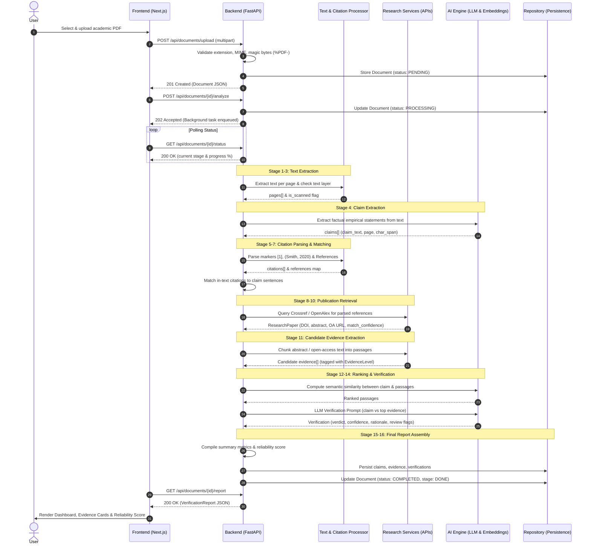

# End-to-End Pipeline Data Flow

This document details the lifecycle of data as it passes through each stage of the CiteVerify AI verification pipeline.

---

## 1. Pipeline Sequence Diagram

---

## 2. Pipeline Stage Details & Artifacts

| Stage | Name | Input | Output | Primary Component |
|---|---|---|---|---|
| **1** | Upload | Binary PDF bytes from user | Staged file in `uploads/` | `app/api/routes/documents.py` |
| **2** | Validation | Binary file header & metadata | Validated file or error envelope | `app/processors/upload_validator.py` |
| **3** | Text Extraction | Staged PDF | Page-by-page text, page count | `app/services/document_processor.py` |
| **4** | Claim Extraction | Page text | List of candidate factual claims | `ai_engine/claim_extractor/` |
| **5** | Citation Parsing | Body text | In-text markers (`[1]`, `Smith et al.`) | `app/services/citation_parser.py` |
| **6** | Reference Parsing | End-of-document text | Parsed bibliography dictionary | `app/services/citation_parser.py` |
| **7** | Citation Matching | Claims & citations | Claims linked to reference text | `app/services/citation_matcher.py` |
| **8** | API Lookup | Reference strings | Scholarly records (Crossref/OpenAlex) | `research_services/` |
| **9** | Match Resolution | Query vs API metadata | `ResearchPaper` with match confidence | `research_services/publication_matcher/` |
| **10**| Text Retrieval | DOI / OpenAlex ID | Abstract or legitimate open-access text | `research_services/` |
| **11**| Evidence Chunking | Paper text/abstract | Atomic passages with `EvidenceLevel` | `research_services/evidence_extractor/` |
| **12**| Semantic Ranking | Claim text & passages | Cosine similarity scores | `ai_engine/embedding_service/` |
| **13**| Verification | Claim + Top evidence passages | NLI inference outcome | `ai_engine/verification_engine/` |
| **14**| Schema Validation | Raw LLM output | Validated `Verification` object | `ai_engine/llm/` |
| **15**| Review Flagging | Confidence, contradictions | `needs_human_review` & trigger reasons | `ai_engine/verification_engine/` |
| **16**| Report Synthesis | All claims & verifications | `VerificationReport` with score (0-100) | `app/services/report_generator.py` |

